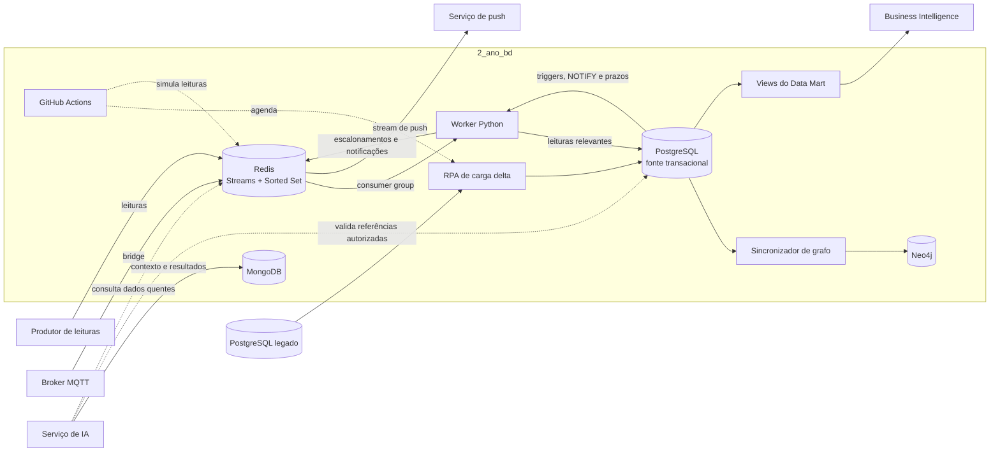

<div align="center">


<br/>

# 2º ano · Bancos de dados

### Persistência, integração e automação dos dados do Skadi

[](#postgresql)
[](#redis)
[](#mongodb)
[](#neo4j)
[](#tecnologias)
[](#licenca)

<a href="#visao-geral"></a>
<a href="#arquitetura"></a>
<a href="#decisoes"></a>
<a href="#estrutura"></a>
<a href="#responsabilidades"></a>

</div>

---

<a id="visao-geral"></a>

## Visão geral

Este repositório concentra a **camada de dados do Skadi**, plataforma de monitoramento térmico de câmaras frigoríficas. Ele reúne os modelos, scripts, integrações e automações que sustentam o registro das temperaturas, a geração e o atendimento de alertas, a auditoria das operações, a análise para BI, a integração com o banco legado e os dados utilizados pela inteligência artificial.

Cada tecnologia possui uma função explícita no ecossistema:

| Componente | Função |
|---|---|
| **PostgreSQL** | Fonte transacional oficial dos cadastros, lotes, leituras persistidas, alertas, atendimentos, relatórios, auditoria e views de BI. |
| **Redis** | Fila quente de leituras, agendamento de escalonamentos e transporte de notificações. |
| **MongoDB** | Persistência documental da IA: conversas, predições, diagnósticos e execuções de agentes. |
| **Neo4j** | Projeção em grafo dos dados relacionais para exploração de vínculos e consultas por traversal. |
| **RPA** | Carga completa ou delta do PostgreSQL legado para o modelo normalizado do segundo ano. |
| **GitHub Actions** | Execução agendada da carga delta e da simulação do ciclo de temperaturas. |

> [!NOTE]
> A API principal, o frontend, o aplicativo mobile e o serviço de IA ficam em repositórios próprios. Este repositório fornece a estrutura de dados e os processos de integração consumidos por essas frentes.

## O que este repositório entrega

- schema, funções, procedures, triggers, índices, roles e auditoria do PostgreSQL;
- deploy consolidado, massa de demonstração, catálogo de dados e documentação de backup;
- Data Mart com views dimensionais para alertas e solicitações de suporte;
- worker Python que integra Redis e PostgreSQL;
- simuladores de leituras, ciclo Redis e entrada MQTT;
- collections validadas e indexadas no MongoDB;
- sincronização PostgreSQL → Neo4j, consultas Cypher e traversal;
- RPA de carga completa e delta a partir do banco legado;
- workflows agendados e um `.env.example` centralizado.

<a id="arquitetura"></a>

## Arquitetura



### Fluxo de monitoramento

1. Um produtor ou bridge MQTT publica a leitura no Stream `skadi:leituras:temperatura`.
2. O worker consome a mensagem por um consumer group.
3. Leituras fora da faixa são gravadas no PostgreSQL. Leituras normais são persistidas quando representam a recuperação de uma câmara com alerta aberto.
4. Triggers calculam a gravidade, criam o alerta e o atendimento pendente e registram a notificação inicial.
5. O worker agenda os prazos de escalonamento em uma sorted set do Redis.
6. Ao atingir os limites de 40% e 70% da vida útil de referência, uma procedure transfere o alerta entre `OPERADOR`, `GESTOR` e `ADMIN`.
7. Novas notificações são publicadas no Stream `skadi:notificacoes:push`.
8. A mensagem de leitura só é confirmada depois da gravação bem-sucedida; `id_evento_redis` garante idempotência.

## Componentes

<a id="postgresql"></a>

### PostgreSQL

É a fonte oficial dos dados operacionais e concentra:

- **cadastro e integração:** estados, centros de distribuição, usuários, vínculos ADMIN–CD, termômetros, categorias, câmaras e lotes;
- **monitoramento:** leituras, alertas, notificações, atendimentos e justificativas;
- **suporte e compliance:** solicitações, relatórios, assinaturas e catálogo de dados;
- **auditoria:** alterações, acessos e escalonamentos;
- **análise:** DAU, transformações ETL e views dimensionais do Data Mart.

O banco também automatiza validações de acesso, compatibilidade térmica entre lotes e câmaras, criação e resolução de alertas, escalonamento, notificações e trilhas de auditoria.

[Documentação detalhada do PostgreSQL](databases/postgresql/README.md) · [Data Mart](databases/postgresql/data-mart.md) · [Índices](databases/postgresql/indices.md) · [Backup e recuperação](databases/postgresql/backup-recuperacao.md)

<a id="redis"></a>

### Redis

O Redis mantém dados temporários e de transporte. O worker utiliza Streams para receber leituras e publicar notificações, além de uma sorted set para controlar os prazos de escalonamento. As regras de negócio permanecem no PostgreSQL, evitando duas implementações diferentes do fluxo de alertas.

O diretório também contém um simulador de leituras, um ciclo completo de simulação e um bridge MQTT → Redis.

[Documentação do worker Redis/PostgreSQL](databases/redis/README.md) · [Workflow de simulação](databases/redis/workflow-simulacao.md)

<a id="mongodb"></a>

### MongoDB

O MongoDB guarda somente documentos gerados ou necessários para a IA nas collections `predicoes`, `diagnosticos`, `conversas` e `execucoes_agentes`. O script aplica validação estrita e índices e pode ser reexecutado sem apagar as collections.

[Documentação do MongoDB](databases/mongodb/README.md)

<a id="neo4j"></a>

### Neo4j

O Neo4j representa como grafo os relacionamentos entre usuários, centros de distribuição, câmaras, termômetros, lotes, categorias, alertas, atendimentos e justificativas. Os dados são sincronizados a partir do PostgreSQL; o grafo é uma projeção para consultas de relacionamento, não a fonte transacional.

[Documentação do Neo4j](databases/neo4j/README.md)

### RPA

O RPA sincroniza o PostgreSQL legado com o banco normalizado. A carga preserva os IDs de origem e utiliza `INSERT ... ON CONFLICT DO UPDATE`. Depois da carga completa, `tb_controle_rpa` permite trazer apenas registros alterados desde a última execução concluída. Exclusões físicas no legado não são propagadas.

[Documentação da carga delta](rpa/README.md)

### GitHub Actions

Dois workflows podem ser acionados manualmente ou pelo agendamento da branch padrão:

| Workflow | Responsabilidade |
|---|---|
| `rpa-carga-delta.yml` | Executa a carga delta do legado a cada cinco minutos, com controle de concorrência. |
| `simulacao-temperaturas.yml` | Executa o ciclo de simulação MQTT/Redis a cada cinco minutos. |

[Documentação dos workflows](.github/workflows/README.md)

<a id="decisoes"></a>

## Principais decisões de arquitetura

| Decisão | Motivo e consequência |
|---|---|
| **PostgreSQL como fonte oficial** | Centraliza integridade, regras transacionais e histórico operacional. Neo4j e MongoDB possuem escopos especializados. |
| **Redis como transporte, não histórico** | Mantém baixa latência sem duplicar as regras de alerta. O PostgreSQL conserva as leituras relevantes para o fluxo operacional. |
| **Processamento idempotente** | `id_evento_redis` e uma constraint única evitam duplicidade no reprocessamento. |
| **Um alerta aberto por câmara** | Uma trigger impede alertas abertos duplicados para a mesma câmara frigorífica. |
| **ADMIN associado a vários CDs** | `tb_admin_cd` representa a relação muitos-para-muitos; `GESTOR` e `OPERADOR` mantêm vínculo direto com um CD. |
| **Categorias e lotes separados** | A categoria concentra faixa térmica e vida útil; o lote guarda validade e histórico de movimentação. |
| **Vida útil como `INTERVAL`** | Prazos aceitam horas e minutos e deixam explícita a unidade temporal. |
| **Valores controlados padronizados** | Perfis, estados e gravidades usam códigos em maiúsculas e sem acentos. |
| **Auditoria com minimização de dados** | Snapshots omitem campos sensíveis e mantêm apenas o necessário para rastreabilidade. |
| **Relatórios verificáveis** | Hash SHA-256 e assinaturas RSA permitem testar integridade; as chaves da massa são demonstrativas. |
| **RPA preserva a origem** | A integração não altera o legado, preserva IDs e converte os dados para o modelo normalizado. |

### Evolução registrada nas Pull Requests

| PRs | Evolução principal |
|---|---|
| [#1](https://github.com/Skadi-Interdisciplinar/2_ano_bd/pull/1) e [#2](https://github.com/Skadi-Interdisciplinar/2_ano_bd/pull/2) | Estrutura inicial e consolidação do PostgreSQL, automações, auditoria, ETL, DAU, índices e roles. |
| [#4](https://github.com/Skadi-Interdisciplinar/2_ano_bd/pull/4) a [#6](https://github.com/Skadi-Interdisciplinar/2_ano_bd/pull/6) | Neo4j, worker Redis/PostgreSQL e MongoDB para a IA. |
| [#7](https://github.com/Skadi-Interdisciplinar/2_ano_bd/pull/7) a [#12](https://github.com/Skadi-Interdisciplinar/2_ano_bd/pull/12) | Super ADM, suporte, RPA, faixas térmicas, valores controlados, intervalos, auditoria e associação ADMIN–CD. |
| [#13](https://github.com/Skadi-Interdisciplinar/2_ano_bd/pull/13) e [#14](https://github.com/Skadi-Interdisciplinar/2_ano_bd/pull/14) | Padronização das gravidades, Data Mart e documentação de backup e recuperação. |
| [#15](https://github.com/Skadi-Interdisciplinar/2_ano_bd/pull/15) a [#18](https://github.com/Skadi-Interdisciplinar/2_ano_bd/pull/18) | Massa de chamados, correções de alertas/RPA e automação da simulação Redis/MQTT. |
| [#19](https://github.com/Skadi-Interdisciplinar/2_ano_bd/pull/19) a [#21](https://github.com/Skadi-Interdisciplinar/2_ano_bd/pull/21) | Alinhamentos entre dataload, RPA, Redis, auditoria, BI e Neo4j. |
| [#22](https://github.com/Skadi-Interdisciplinar/2_ano_bd/pull/22) a [#24](https://github.com/Skadi-Interdisciplinar/2_ano_bd/pull/24) | Organização da documentação e dos índices, tratamento de e-mails duplicados no RPA e ajuste dos agendamentos. |

> [!NOTE]
> A numeração pública não possui uma PR nº 3 nem uma PR nº 17. Isso não representa componentes ausentes da arquitetura.

<a id="estrutura"></a>

## Estrutura do repositório

```text
2_ano_bd/
├── .github/
│   ├── PULL_REQUEST_TEMPLATE.md
│   └── workflows/             # carga delta e simulação agendadas
├── databases/
│   ├── postgresql/            # schema, regras, auditoria, BI e deploy
│   ├── redis/                 # worker, simuladores e bridge MQTT
│   ├── mongodb/               # collections, validações e índices da IA
│   └── neo4j/                 # grafo, sincronização, queries e diagramas
├── rpa/                       # carga completa e delta do banco legado
├── .env.example               # contrato das variáveis de ambiente
├── .gitignore
├── LICENSE
└── README.md
```

## Tecnologias

| Tecnologia | Uso | Dependências registradas |
|---|---|---|
| **PostgreSQL / PL/pgSQL** | Modelo relacional, transações, constraints, functions, procedures, triggers, views, roles e auditoria. | `psycopg[binary] >= 3.2, < 4` nos integradores. |
| **Redis** | Streams, consumer groups, sorted set e transporte de notificações. | `redis >= 5.0, < 6`. |
| **MQTT** | Entrada de leituras simuladas para o Redis. | `paho-mqtt >= 2.1, < 3`. |
| **MongoDB** | Documentos e contexto da IA com validação estrita. | `pymongo >= 4.10, < 5`. |
| **Neo4j / Cypher** | Projeção em grafo e consultas por relacionamento. | `neo4j >= 5.25, < 7`. |
| **Python** | Worker, simuladores, RPA e sincronizadores. | `python-dotenv >= 1.0, < 2` e drivers específicos. |
| **GitHub Actions** | Agendamento e execução das integrações. | Workflows YAML e Secrets do repositório. |

Os ambientes documentados pela organização são PostgreSQL e Redis na Aiven, MongoDB Atlas e Neo4j Aura. As credenciais ficam fora do Git e devem ser fornecidas por variáveis de ambiente ou Secrets.

## Configuração e execução

1. Clone o repositório e copie `.env.example` para `.env`.
2. Preencha apenas as conexões do componente que será executado.
3. Em um PostgreSQL novo e descartável, execute `databases/postgresql/deploy.sql`.
4. Execute opcionalmente `databases/postgresql/dataload.sql` uma única vez para carregar a massa de demonstração.
5. Execute `databases/postgresql/data-mart.sql` para criar as views dimensionais.
6. Instale o `requirements.txt` do componente Python desejado e siga o README da pasta.

> [!WARNING]
> `deploy.sql` contém operações `DROP ... CASCADE`. Não o execute sobre um banco com dados que precisem ser preservados. Este repositório não fornece migração automática para bancos existentes.

| Componente | Comando principal |
|---|---|
| Redis | `python databases/redis/worker.py` |
| Simulação | `python databases/redis/simulacao_ciclo.py` |
| Bridge MQTT | `python databases/redis/mqtt_to_redis.py` |
| MongoDB | `python databases/mongodb/criar_mongodb.py` |
| Neo4j | `python databases/neo4j/load_graph.py` |
| RPA | `python rpa/carga_delta.py --completa` na primeira carga; depois, sem `--completa` |

> [!WARNING]
> Nunca versione `.env`, senhas, tokens, chaves privadas, dumps de banco ou dados pessoais. Compartilhe apenas `.env.example`, sem valores sensíveis.

<a id="responsabilidades"></a>

## Responsabilidades

O README da organização define **[Enzo Soares Nascimento](https://github.com/Enzo-Nasci)** como responsável pelos repositórios do segundo ano. No `2_ano_bd`, o histórico de commits e Pull Requests registra atuação direta de **[Giovanna Santos](https://github.com/giiovannasantoss)** e **[Mariana Proque](https://github.com/MarianaProque)**.

| Parte | Responsabilidade técnica observada no histórico |
|---|---|
| Coordenação dos repositórios do 2º ano | **Enzo Soares Nascimento** — responsável geral indicado pela organização. |
| PostgreSQL e documentação relacional | **Giovanna Santos** — implementação predominante; **Mariana Proque** — evolução de integrações, RPA, auditoria, BI, backup, regras e massa de dados. |
| Redis | **Giovanna Santos** — worker e integração inicial; **Mariana Proque** — simuladores, MQTT, workflows e ajustes de confiabilidade. |
| Neo4j | **Giovanna Santos** — configuração, sincronização, consultas e traversal; **Mariana Proque** — alinhamentos ao schema atual. |
| MongoDB | **Mariana Proque** — estrutura, validações e índices; **Giovanna Santos** — configuração compartilhada. |
| RPA | **Mariana Proque** — implementação e manutenção predominantes; **Giovanna Santos** — compatibilização inicial com os intervalos. |
| GitHub Actions | **Mariana Proque** — automações da carga delta e da simulação; **Giovanna Santos** — estrutura inicial do template de PR. |

> [!NOTE]
> A tabela descreve a autoria evidenciada pelo Git; ela não substitui a definição formal de pessoas mantenedoras, revisoras ou aprovadoras.

## Como contribuir

O desenvolvimento utiliza branches por frente, Conventional Commits e Pull Requests:

1. atualize sua branch a partir de `main`;
2. mantenha scripts modulares e `deploy.sql` sincronizados;
3. descreva impactos de schema, dados existentes e compatibilidade;
4. valide constraints e, quando aplicável, functions, procedures, triggers, carga e deploy;
5. atualize a documentação do componente;
6. não inclua segredos, dumps ou arquivos temporários;
7. peça revisão a uma pessoa diferente da autora da mudança.

Consulte o [guia de desenvolvimento da organização](https://github.com/Skadi-Interdisciplinar/.github/blob/main/CONTRIBUTING.md) e o [template de Pull Request](.github/PULL_REQUEST_TEMPLATE.md).

<a id="licenca"></a>

## Licença

Este repositório é distribuído sob a [licença MIT](LICENSE).

---

<div align="center">

### Dados confiáveis para agir antes que a perda aconteça

<sub>Parte do ecossistema Skadi — monitoramento inteligente de câmaras frigoríficas.</sub>

</div>
